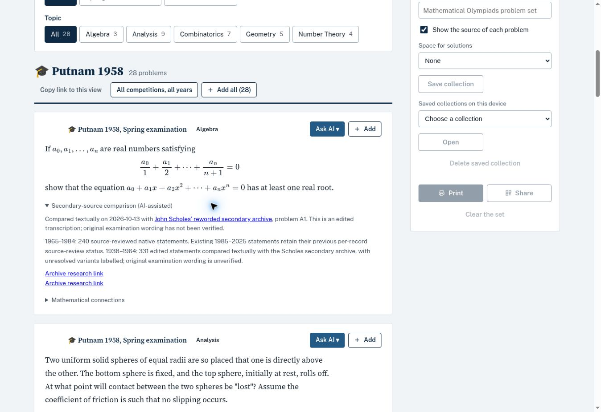

# Putnam early native publication

Published on 2026-10-13: 331 edited English/LaTeX statements for 1938–1964, preserving 25 examinations across 24 held calendar years. No competitions are invented for 1943–1945. Both 1958 examinations retain separate paper identifiers (Spring=1, Fall=2). The published Putnam series now contains 1,063 numbered statements.

The early statements were compared individually with John Scholes’ explicitly reworded archive at https://prase.cz/kalva/putnam.html. They are edited secondary-source transcriptions, not certified facsimiles or verified original examination wording. Every early record retains statement_verified=false and original_wording_verified=false. Formula restorations, source differences and interpretive conventions are recorded in the reproducible correction module and statement metadata. Unresolved source issues are visibly labelled “Source issue — awaiting verification”. No solutions were imported.

The 1947 A3 diagram is a labelled reconstruction of the configuration, not an examination image. Formula text is native LaTeX. The previously published 732 statements and their source-review status are preserved.

Validation: all 19 JavaScript suites and 11 Python unit tests passed; data, topics, DNA, historical-source integrity and runtime metadata checks passed. MathJax rendered all 6,425 mathematical expressions without TeX errors. GitHub validation, historical audit and Pages deployment succeeded for commit 5cc24b787609594dad3e6d34eb40976a58a55d91. Remote bytes matched all 22 publication files.

Live checks covered 1938 (13 cards), 1947 (12 cards and loaded reconstructed diagram), 1958 (28 cards, 14 per examination), 1959 (14 cards and unresolved-variant badge), and 1960 (14 cards). No MathJax error nodes were found in these views. Undergraduate total: 1,846.

Verified view: https://eisatopon.github.io/national-olympiads-bank/?c=put&y=1958

