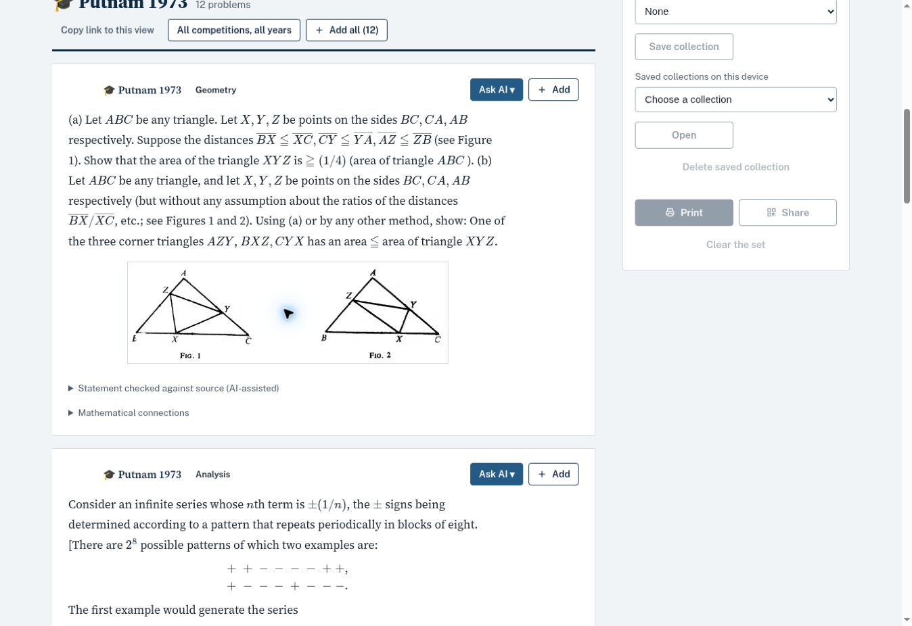

# Putnam historical native statement review

The 1965–1984 checkpoint contains 240 source-reviewed statements in English prose and LaTeX. The checkpoint file remains research material; its 240 reviewed statements are now included in the published 1965–2025 collection. The full 1938–1984 historical import is not complete. The public Putnam collection now contains 732 statements: 240 reviewed historical statements plus 492 preexisting recent records, with twelve rendering-only repairs. The published copy has a reviewed primary topic for every historical statement. Problem DNA fields remain empty where no technique has been certified.

## Sources and verification scope

For 1965–1979, the printed problem pages of the MAA compilation by G. L. Alexanderson, L. F. Klosinski and L. C. Larson were visually compared with each transcription in the [public image viewer](https://www.scribd.com/document/629286756/Putnam-1965-1984). Viewer pages 15–46 correspond to printed pages 3–34. Both page numbering schemes are retained; references are to the year’s problem-page range rather than a guessed single page for every statement.

For 1980–1984, the 59 existing visual comparisons with examination PDFs hosted by UCSD were retained. The remaining 1982 B5 statement was checked against viewer page 52, printed page 40, of the MAA compilation. This restores the missing recursion index in the UCSD typesetting. The high-resolution [publisher excerpt](https://assets.cambridge.org/97808838/54631/excerpt/9780883854631_excerpt.pdf), PDF page 2, also confirms the two subscripts in 1965 A3.

No solutions were imported. The compilation source itself includes solutions elsewhere, which is recorded in each relevant source reference. This source review is AI-assisted visual comparison, not independent human certification.

## Transcription repairs

49 statements received transcription repairs or native prose cleanup. Repairs include the subsequence index in 1965 A3, indices in the 1967 A6 linear system, the matrix notation in 1968 B5, the missing absolute-value boundary in 1971 B6, four consecutive binomial coefficients and a factorial denominator in 1972, the cubic sine exponent in 1973 B6, the limit direction and Taylor remainder in 1974, the third group generator and constraint exponent in 1975, and the missing recursion index in 1982 B5. Introductory labels are removed from statement bodies and math delimiters use native dollar syntax.

Three issues already present in the printed source are retained with separate English notes: the strict inequality in 1978 A5, the incomplete recurrence initialization in 1978 B3, and the strict inequality in 1979 B6. They are not silently changed into different questions.

Four original diagrams are retained in three crops: two triangle configurations for 1973 A1, the descent diagram for 1974 A2, and the rolling-parabola diagram for 1974 A5. These crops contain diagrams and their labels, not scanned statement text.

## Unresolved historical coverage

The earlier 1938–1964 inputs contain 331 candidate records, including separately stored spring and autumn editions in 1958. The published Gleason–Greenwood–Kelly compilation describes 347 problems. The counting difference has not been reconciled against the original pages and is not treated as an automatic list of 16 missing questions. Alternative questions and original numbering require comparison with the book.

The original 1938–1964 compilation has been located bibliographically, but a full readable primary source was not obtained. Catalog records, limited previews and Scholes’s explicitly reworded statements do not establish exact original wording. The Scholes secondary archive has now been recovered: all 331 numbered statements from 25 editions correspond to the existing early candidate identities, including both 1958 editions. This establishes secondary-source coverage, not exact original wording or mathematical fidelity. The 1938–1964 candidates remain outside the public UI while their mathematical comparison proceeds. The required next source is the problem section of the Gleason–Greenwood–Kelly volume, ISBN 9780883854624, or original examination papers covering those years.

## Reproduction and checks

Run `python scripts/build_putnam_1965_1984_review.py`, then `node tests/test_putnam_historical_native_review.cjs`. The builder pins the exact three reviewed input files by SHA-256 and refuses to certify modified inputs. Each output statement and diagram has its own SHA-256. The original research inputs are preserved.

All 240 statements were tested with MathJax 3.2.2; the final pass rendered 1,477 math expressions without TeX errors. All 732 statements also passed the final MathJax render check: 4,838 expressions, zero TeX errors. Diagram crops were visually inspected. The already published 1985–2025 records retain their previous source-review status. Twelve nested-dollar expressions inside text macros were repaired for native MathJax rendering without changing hypotheses or formulas; input statement hashes are retained for those repairs.

## Live publication checks

The live bank was checked after deployment. Putnam now covers 1965–2025 with 732 records; the Undergraduate section contains 1,515 records. Representative views from 1965, 1973, 1974, 1978, 1982, 1987 and 2023 each displayed 12 cards without MathJax errors. All four original diagrams loaded in the three diagram assets. Source-review badges now support multi-page ranges, and printed source defects are shown as awaiting verification rather than as mathematically certified questions.

The summary manifest includes every registered Undergraduate collection, so the overall counter includes IMC and SEEMOUS as well as Putnam, Simon Marais and Jarník. All root collections and their grid ordering remain unchanged.

